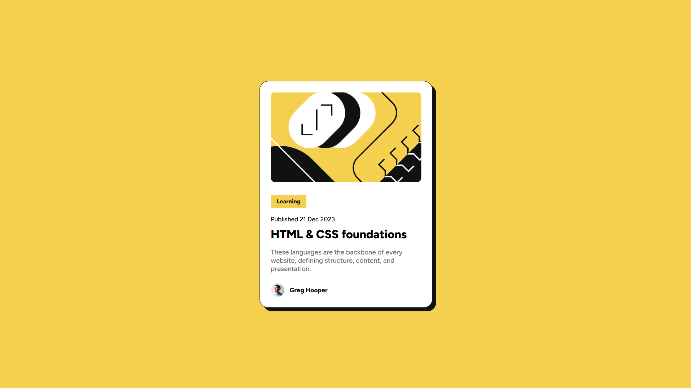

# Frontend Mentor - Blog preview card solution

This is a solution to the [Blog preview card challenge on Frontend Mentor](https://www.frontendmentor.io/challenges/blog-preview-card-ckPaj01IcS). Frontend Mentor challenges help you improve your coding skills by building realistic projects. 

## Table of contents

- [Overview](#overview)
  - [The challenge](#the-challenge)
  - [Screenshot](#screenshot)
  - [Links](#links)
- [My process](#my-process)
  - [Built with](#built-with)
  - [What I learned](#what-i-learned)
  - [Continued development](#continued-development)
  - [Useful resources](#useful-resources)
  - [AI Collaboration](#ai-collaboration)
- [Author](#author)
## Overview

### The challenge

Users should be able to:

- See hover and focus states for all interactive elements on the page

### Screenshot



### Links

- Solution URL: [GitHub Repository](https://github.com/Lueslin/blog-preview-card)
- Live Site URL: [Live Site](https://lueslin.github.io/blog-preview-card/)

## My process

### Built with

- Semantic HTML5 markup (`<main>`)
- CSS custom properties (`:root` variables)
- CSS Flexbox
- Mobile-first workflow
- [Google Fonts](https://fonts.google.com/) - Figtree font family (500 & 800)

### What I learned

- **CSS Custom Properties (`:root`):** Defining color palettes and typography tokens at the root level made it much easier to reuse values like `--yellow` across the page background, category tag, and title hover state.
- **Neobrutalist Card Styling & Interactivity:** Combining a solid `1px` border with a hard offset shadow (`box-shadow: 8px 8px 0px`) and adding smooth `:hover` color transitions on the `<h1>` heading.
- **Nested Flexbox Alignment:** Using Flexbox both to center the card on the viewport (`min-height: 100vh`) and to align the author's circular avatar and name horizontally inside the card footer.

```css
:root {
  --yellow: #f4d04e;
  --black: #111;
  --font: "Figtree", sans-serif;
  --white: #fff;
  --grey: #6a6a6a;
}

.blog-card {
  background-color: var(--white);
  display: flex;
  flex-direction: column;
  align-items: flex-start;
  max-width: 384px;
  width: 100%;
  padding: 24px;
  border: 1px solid var(--black);
  border-radius: 20px;
  box-shadow: 8px 8px 0px var(--black);
}

### Continued development

Moving forward, I plan to explore :focus-visible states for keyboard accessibility, practice CSS Grid for multi-column layouts, and start introducing JavaScript for dynamic DOM manipulation in upcoming challenges.

### Useful resources

- [MDN Web Docs - Using CSS custom properties (variables)](https://developer.mozilla.org/en-US/docs/Web/CSS/CSS_cascading_variables/Using_CSS_custom_properties) - Helped me understand how to define reusable color and typography tokens inside `:root` and apply them cleanly with `var()`.
- [MDN Web Docs - box-sizing](https://developer.mozilla.org/en-US/docs/Web/CSS/box-sizing) - Great reference for understanding why `box-sizing: border-box` keeps card widths predictable when adding padding and borders.
- [A Complete Guide to Flexbox (CSS-Tricks)](https://css-tricks.com/snippets/css/a-complete-guide-to-flexbox/) - Essential guide for centering the card on the viewport and aligning the author's avatar and name horizontally.

### AI Collaboration

I worked with Gemini as an interactive coding mentor throughout this challenge. Rather than relying on generated code, I structured the semantic HTML and wrote the CSS independently—using AI feedback to validate my Flexbox alignment, understand box-sizing: border-box, refine :hover transitions, and organize atomic Git commits.

## Author

- Website - [Lueslin Camacho](www.behance.net/logicbylueslin)
- Frontend Mentor - [@lueslin](https://www.frontendmentor.io/profile/lueslin)
